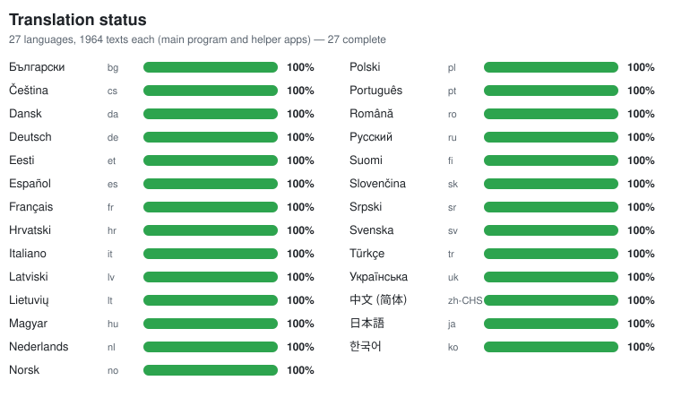

# AgOpenGPS - Guidance software

# 🚧 Project Status: Active Development

This fork of AgOpenGPS WinForms is under active development.

- ✅ New features and improvements
- ✅ Bug fixes

---


[](https://github.com/trueAnonymous808/agopengps_software/releases/latest)
[](#translation-status)

Ag Precision Mapping and Section Control Software

AgOpenGPS is 2 programs. AgIO is the communication hub to the outside world and AgOpenGPS is the 
application. You can run either and within each, you can run the other.

You only need to run AgOpenGPS if you are using the simulator.

The software reads NMEA strings for the purpose of recording and mapping position information 
for Agricultural use. Also it has up to 16 sections of Section Control that can have unique widths 
or up to 64 same width sections to control implements application of product preventing 
over-application.

Also ouputs Pure pursuit steer angles from reference line for AB line, AB Curve and Contour guidance. 
Auto Headland called UTurn on Curve and AB Line with loops for narrow equipment. 
Mapping as a background can also be added.

Included in this repository is an application, and source folders. 

See the PCB repo for PCB layouts, firmware for steering and rate control, machine control, GPS and simulator. 

## Installation

1. Download the [Latest AgOpenGPS Release](https://github.com/trueAnonymous808/agopengps_software/releases)
2. Unzip or extract the contents to a folder (folder accessible by user not the root of C:\\)
Even on your desktop
3. Run AgOpenGPS.exe

## Building

1. Clone this repository (e.g. use Visual Studio to do so)
2. Open the solution (`SourceCode/AgOpenGPS.sln`) in Visual Studio
3. Add your code and (re)build
4. Execute the following command in the root folder to get a single `AgOpenGPS` folder containing all the applications:
   ```sh
   dotnet publish SourceCode/AgOpenGPS.sln
   ```

## Contributing

The `master` branch contains the most stable version of AgOpenGPS, while the `develop` branch
is actively being worked on and may not be ready for production use.

In order to contribute to AgOpenGPS, follow these steps:

1. Checkout the `develop` branch
2. Create a new branch named after your feature
3. Make your changes and commit to this branch
4. Create a PR targeting the `develop` branch

## Translation

We use [Weblate](https://weblate.org) to manage translations for this project.

If you want to help translate AgOpenGPS, follow these steps:

1. Create (or log in to) your free account on [Weblate](https://hosted.weblate.org)
2. Go to the [AgOpenGPS Project on Weblate](https://hosted.weblate.org/engage/agopengps)
3. Select your language (or add a new one if it's missing)
4. Translate strings directly in the web interface

### Translation Status

This fork ships all 27 languages of the language menu complete: the main program and the helper apps
(AgIO, GPS_Out, ModSim, AgDiag, Updater) follow the language chosen in AgOpenGPS, and an open window switches
without a restart.



Български, Čeština, Dansk, Deutsch, Eesti, English, Español, Français, Hrvatski, Italiano, Latviski, Lietuvių,
Magyar, Nederlands, Norsk, Polski, Português, Română, Русский, Suomi, Slovenčina, Srpski, Svenska, Türkçe,
Українська, 中文 (简体), 日本語, 한국어

All texts are in `SourceCode/AgOpenGPS.Core/Translations/gStr.<language>.resx`. Many of them are machine
translations: corrections from native speakers are welcome. After changing a translation, refresh the image with
`powershell -ExecutionPolicy Bypass -File docs\translation-status.ps1`.

Status of the upstream AgOpenGPS project on Weblate:

[](https://hosted.weblate.org/engage/agopengps/)

## Links

- [AgOpenGPS Documentation](https://docs.agopengps.com/)
- [AgOpenGPS Forum](https://discourse.agopengps.com/)
- [PCB and Firmware Repository](https://github.com/agopengps-official/Boards)
- [SK21 Rate Control Repository](https://github.com/agopengps-official/Rate_Control)

## License

AgOpenGPS is licensed under the [Apache License 2.0](LICENSE).

You may use, modify and distribute this software, including commercially. If you distribute it, in original or modified form, you must include a copy of the license, keep the existing copyright and attribution notices, and mark any files you changed.

The software is provided "AS IS", without warranties or conditions of any kind. See the [LICENSE](LICENSE) file for the full terms.
